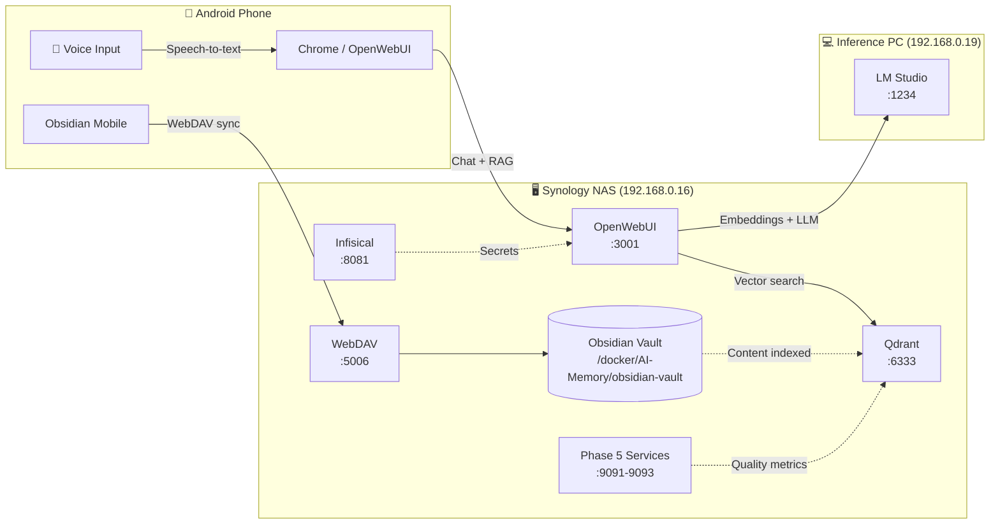
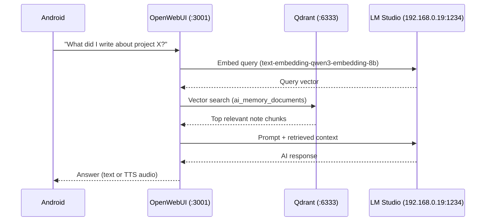
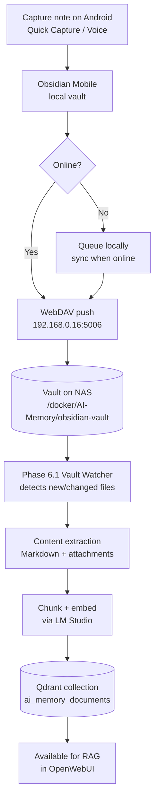
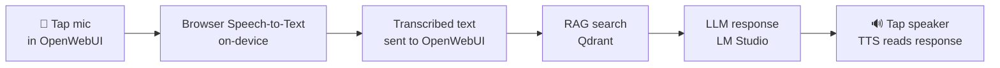
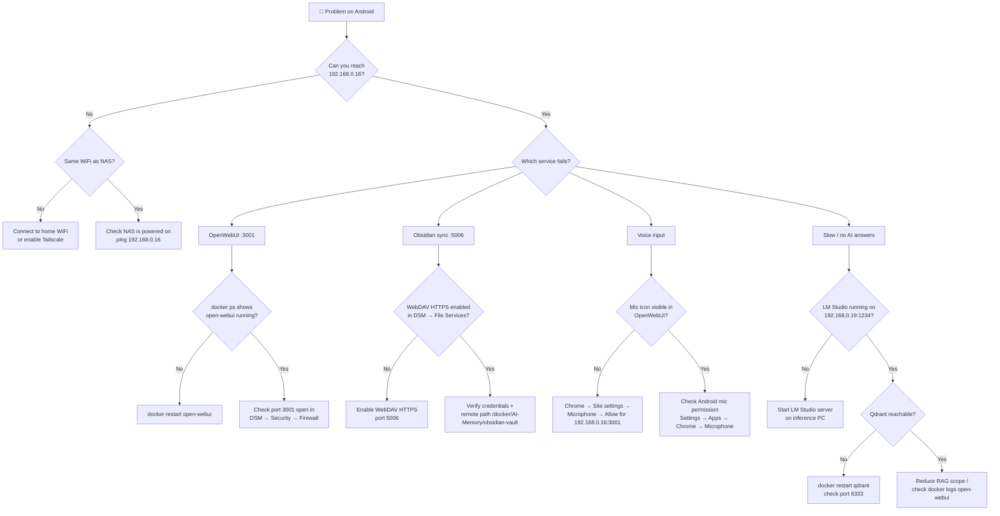

# Mobile User Guide for AI Memory Pipeline

Complete step-by-step instructions for using AI Memory Pipeline on Android devices.

---

## Table of Contents

1. [Quick Start (5 minutes)](#quick-start-5-minutes)
2. [System Architecture](#system-architecture)
3. [OpenWebUI Setup](#openwebui-setup)
4. [Obsidian Mobile Setup](#obsidian-mobile-setup)
5. [Voice Capture Guide](#voice-capture-guide)
6. [Workflow Examples](#workflow-examples)
7. [Troubleshooting](#troubleshooting)
8. [Advanced Configuration](#advanced-configuration)
9. [Tips for Best Experience](#tips-for-best-experience)
10. [Support](#support)

---

## Quick Start (5 minutes)

### What You'll Get

- **Desktop Chat Interface**: Full-featured chat with your knowledge base
- **Mobile Access**: Use the same interface on your phone
- **Voice Input**: Speak your thoughts, get voice responses
- **RAG Search**: Chat with your Obsidian notes and Qdrant database

### Step-by-Step Setup

#### 1. Verify Services Are Running (on Synology NAS)

```bash
# SSH into your Synology NAS or use Docker UI
docker ps
```

You should see:
- `open-webui` running on port 3001
- `qdrant` running on port 6333
- `lm-studio` accessible on port 1234

#### 2. Access OpenWebUI from Android

1. **Open Chrome browser** on your Android phone
2. **Go to**: `http://192.168.0.16:3001`
3. **You should see the OpenWebUI login screen**

#### 3. Create Your First Chat

1. **Type a message** like "Hello, what do I have in my notes about project X?"
2. **Press Send**
3. **AI will search your Obsidian vault and respond**

---

## System Architecture

### How It All Fits Together



### Data Flow: A Chat Message



### Obsidian Sync Flow



### Voice Capture Flow



---

## OpenWebUI Setup

### Installation (Already Done on Synology)

OpenWebUI is deployed on your Synology NAS at `http://192.168.0.16:3001`.

### Android Configuration

#### Step 1: Add to Home Screen

1. **Open Chrome** → Navigate to `http://192.168.0.16:3001`
2. **Tap the three dots menu** (top right)
3. **Select "Add to Home screen"**
4. **Name it**: "AI Memory Chat"
5. **Tap Add**

Now you have an app-like icon on your home screen!

#### Step 2: Configure Models

1. **Open OpenWebUI** from home screen
2. **Tap the profile icon** (top right, looks like a person)
3. **Select "Settings"**
4. **Go to "Models" tab**

**Add LM Studio Model**:
```
Model Name: qwen3-coder-next
API Base URL: http://192.168.0.16:1234/v1
```

Click **Save**.

#### Step 3: Configure RAG (Retrieval Augmented Generation)

RAG allows AI to search your Obsidian notes before responding.

1. **Go to Settings** → **Files**
2. **Configure Qdrant Connection**:
   ```
   Qdrant URL: http://192.168.0.16:6333
   Collection Name: ai_memory_documents
   Embedding Model: text-embedding-qwen3-embedding-8b
   ```

3. **Click "Test Connection"** to verify
4. **Click "Save"**

#### Step 4: Enable Voice Features

1. **Go to Settings** → **Audio**
2. **Enable Text-to-Speech**: Toggle ON
3. **Select Voice**: Choose your preferred voice
4. **Enable Speech-to-Text**: Toggle ON
5. **Click "Save"**

---

## Obsidian Mobile Setup

### Why Use Obsidian?

- **Note-taking**: Capture thoughts anytime
- **Sync**: Automatically sync with your Synology NAS
- **Templates**: Quick capture templates for different note types
- **Graph View**: Visualize connections between your notes

### Installation

1. **Open Google Play Store**
2. **Search for "Obsidian"**
3. **Install the official app** (by Obsidian Helium)
4. **Open the app**

### Connect to Your Vault

#### Method A: Synology Sync (Recommended)

1. **In Obsidian app**: Tap the gear icon (⚙️) → **Sync**
2. **Select "Synology"**
3. **Enter your Synology NAS credentials**:
   ```
   Host: 192.168.0.16
   Port: 5005 (HTTP) or 5006 (HTTPS)
   Username: Your Synology username
   Password: Your Synology password
   Remote Path: /docker/AI-Memory/obsidian-vault
   ```

4. **Tap "Connect"**
5. **Select your vault** from the list

#### Method B: WebDAV

If Synology sync doesn't work:

1. **Enable WebDAV on Synology**:
   - Open **Synology DSM** → **Control Panel** → **File Services**
   - Enable **WebDAV HTTPS**

2. **In Obsidian**: Select "WebDAV" and enter:
   ```
   Server: https://192.168.0.16:5006
   Username: Your Synology username
   Password: Your Synology password
   ```

### Quick Capture Setup

#### Create Quick Capture Template

1. **In Obsidian**: Go to Settings → **Quick Capture**
2. **Enable Quick Capture**
3. **Set up template**:

```markdown
---
created: {{date}} {{time}}
tags: quick-capture
source: mobile
---

{{selection}}
```

4. **Save**

#### Add Quick Capture to Home Screen

1. **Open Obsidian** → Tap three dots menu
2. **Select "Quick Capture"**
3. **Tap "Add to Home screen"**

### Voice Recording Integration

Obsidian doesn't have built-in voice recording, but you can:

#### Option 1: Use Android Voice Recorder

1. **Open Voice Recorder** app
2. **Record your note**
3. **Save to**: `/docker/AI-Memory/obsidian-vault/VoiceNotes/`
4. **Transcribe later** using AI tools

#### Option 2: Use Third-Party App

Install **"Audio Note Pro"** from Google Play Store:
- Records audio
- Adds timestamp to filename
- Syncs with Obsidian folder

---

## Voice Capture Guide

### Using OpenWebUI Voice Features

#### Speak to AI

1. **Open OpenWebUI** on your phone
2. **Tap the microphone icon** (bottom left, looks like a sound wave)
3. **Speak your message clearly**
4. **AI will transcribe and respond**

#### Listen to AI Responses

1. **When AI responds**, look for the speaker icon (🔊) on the response
2. **Tap it** to hear the response aloud
3. **Adjust speed** in Settings → Audio (0.5x to 2x)

### Best Practices for Voice Capture

| Scenario | Tip |
|----------|-----|
| **Meeting Notes** | Say "Meeting Note:" at start, then speak key points |
| **Idea Capture** | Speak quickly, AI will transcribe and organize |
| **Questions** | Start with "Question:" to signal AI mode |

### Voice Settings Optimization

**For better transcription**:
1. **Go to Settings** → **Audio**
2. **Enable noise suppression**: ON
3. **Set language**: English (or your language)
4. **Adjust sensitivity**: Medium

---

## Workflow Examples

### Example 1: Quick Thought Capture

1. **Open Quick Capture** (from home screen)
2. **Speak**: "I need to buy groceries: milk, eggs, bread"
3. **Save note** → Automatically syncs to Synology
4. **Later**: AI can search this in your vault

### Example 2: Deep Conversation with AI

1. **Open OpenWebUI** app icon
2. **Speak**: "What did I write about project management last week?"
3. **AI searches** your Obsidian vault
4. **Listen to response** while doing other tasks

### Example 3: Voice Meeting Notes

1. **Start recording** in Voice Recorder
2. **Speak your meeting notes**
3. **Stop recording** → Save to Obsidian folder
4. **Later**: Use AI to summarize the meeting

---

## Troubleshooting

### Troubleshooting Decision Tree



### Common Issues and Solutions

#### Issue 1: Cannot Connect to OpenWebUI

**Symptoms**: 
- Browser shows "connection refused"
- Page doesn't load

**Solutions**:
```bash
# Check if OpenWebUI is running on Synology
docker ps | grep open-webui

# Restart if needed
docker restart open-webui
```

**Check network**:
1. Ensure Android phone is on **same WiFi** as Synology NAS
2. Test connectivity: `ping 192.168.0.16` (requires Termux or ADB)

#### Issue 2: Voice Not Working

**Symptoms**:
- Microphone icon not appearing
- Speech-to-text fails

**Solutions**:
1. **Check browser permissions**:
   - Chrome → Settings → Privacy and security → Site settings → Microphone
   - Ensure `192.168.0.16:3001` has microphone access

2. **Restart OpenWebUI**:
```bash
docker restart open-webui
```

#### Issue 3: Sync Failing in Obsidian

**Symptoms**:
- Notes not syncing to Synology
- Error messages about connection

**Solutions**:
1. **Check Synology WebDAV settings**:
   - DSM → File Services → WebDAV HTTPS enabled
   - Port 5006 open

2. **Test WebDAV manually**:
```bash
# Install cadaver (WebDAV client)
pkg install cadaver

# Test connection
cadaver https://192.168.0.16:5006
```

#### Issue 4: AI Responses Are Slow

**Symptoms**:
- Long wait time for responses
- Timeout errors

**Solutions**:
1. **Check LM Studio is running**:
```bash
docker ps | grep lm-studio
```

2. **Restart services**:
```bash
docker restart open-webui
docker restart qdrant
```

3. **Reduce RAG scope** in Settings → Files → Limit search to specific collections

#### Issue 5: Mobile Data Not Working

**Symptoms**:
- Works on WiFi but not mobile data

**Solutions**:
- Synology NAS is on local network, mobile data won't work directly
- **Solution**: Set up VPN or port forwarding (advanced)

---

## Advanced Configuration

### Custom Settings for Better Performance

#### OpenWebUI Config (.env.openwebui)

```bash
# Increase timeout for slow responses
WEBUI_TIMEOUT=60

# Enable caching
ENABLE_CACHE=true

# Optimize for mobile
MOBILE_OPTIMIZED=true
```

#### Obsidian Mobile Settings

1. **Settings** → **Files**
   - Sync interval: 5 minutes
   - Max sync size: 100MB
   - Auto-upload media: ON

2. **Performance**
   - Disable plugins you don't use
   - Limit open tabs

---

## Tips for Best Experience

### Daily Workflow

1. **Morning**: Check OpenWebUI for overnight AI summaries
2. **Throughout day**: Use Quick Capture for thoughts
3. **Evening**: Review voice notes and organize
4. **Weekly**: Let AI categorize and link notes

### Recommended Plugins (Desktop)

Install these in Obsidian desktop first, they sync to mobile:

- **Templater**: For advanced templates
- **Calendar**: For date-based notes
- **Dataview**: For querying your notes
- **Task Manager**: For tracking tasks from notes

---

## Support

### Getting Help

1. **Check logs**:
```bash
docker logs open-webui
docker logs qdrant
```

2. **Test connectivity**:
```bash
# From Android (requires Termux)
curl http://192.168.0.16:3001
curl http://192.168.0.16:6333
```

3. **Review documentation**:
- [OpenWebUI Docs](https://docs.openwebui.com)
- [Obsidian Docs](https://help.obsidian.md)

---

## Summary

| Task | How to Do It |
|------|--------------|
| **Chat with AI** | Open `http://192.168.0.16:3001` on phone |
| **Quick Capture** | Use Obsidian Quick Capture template |
| **Voice Notes** | Record in Voice Recorder, save to vault |
| **Listen to AI** | Tap speaker icon on responses |
| **Sync Notes** | Obsidian auto-syncs every 5 minutes |

---

**Happy Capturing! 🎉**
